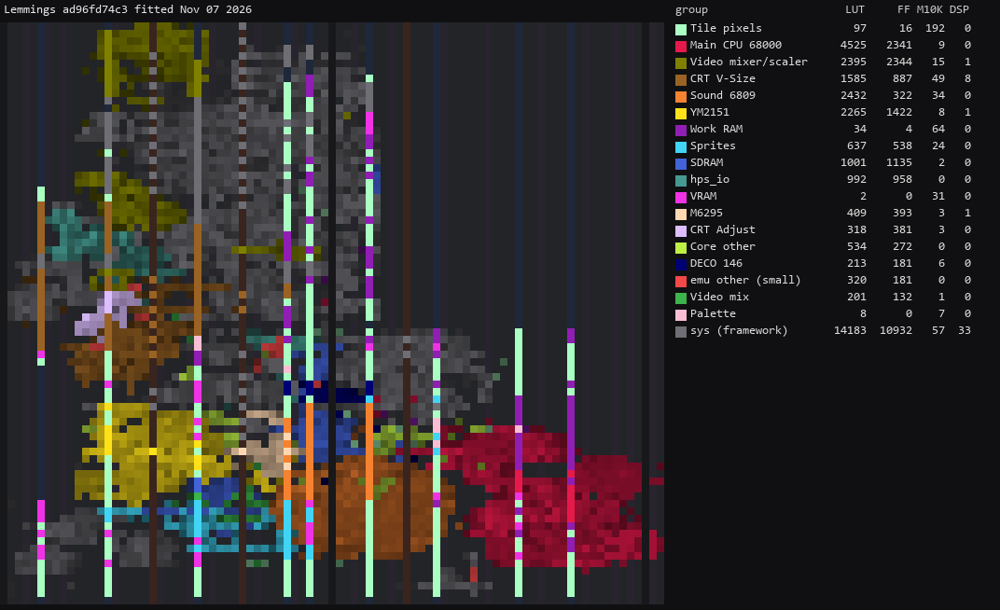
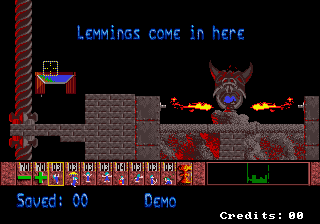
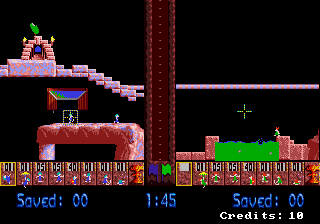

# Lemmings core for MiSTer

A MiSTer FPGA core for Data East's Lemmings arcade hardware (DE-0357, MAME's
`dataeast/lemmings.cpp`), built with Quartus Prime 17.0.2 Lite for the DE10-nano.

**Status: first release, 20261108. Plays one and two players, with sound, on a DE10-nano.**

## Contents

- [History](#history)
- [Games](#games)
  - [Supported](#supported)
- [Hardware](#hardware)
  - [Video timing](#video-timing)
  - [Floorplan](#floorplan)
- [Screenshots](#screenshots)
- [Installation](#installation)
- [Controls](#controls)
- [Status](#status)
  - [Todo](#todo)
  - [Resource usage](#resource-usage)
- [AI Attestation](#ai-attestation)
- [Verification](#verification)
- [Acknowledgements](#acknowledgements)
- [Layout](#layout)
- [License](#license)

## History

**20261108**, `releases/Arcade-Lemmings_20261108.rbf`: commit ad96fd7, default fitter seed, `Lemmings`
revision. Worst slack per clock: `clk_sys` setup +2.860 ns, hold +0.177 ns; HDMI setup +0.553 ns;
every other clock above that. First release.

Earlier builds on hardware:

- ad96fd7: mouse buttons, left Select and right Hurry.
- b562f9f: the 68000's pixel-layer reads fixed; terrain no longer shows black columns.
- b575647: sound (6809, YM2151, M6295).
- 17d5f82: first build with correct sprites.

## Games

One set, the driver's only one: the US prototype, which never went past field test. It needs
about 2.1 MB of SDRAM, so any module works.

### Supported

Sets with an `.mra` in `releases/`. `lemmings` has run on hardware.

| Name | Year | Manufacturer | Set | Notes |
|-|-|-|-|-|
| Lemmings (US prototype) | 1991 | Data East USA | `lemmings` | |

## Hardware

| Chip | Function | Status |
|-|-|-|
| 68000, 14 MHz | main CPU | fx68k, vendored unchanged; boot trace equal to MAME's for 500,000 accesses |
| MC6809E, 1.3425 MHz | sound CPU | mc6809i, vendored unchanged; chip writes equal to MAME's to frame 1500 |
| YM2151, 3.58 MHz | FM sound | jt51, vendored unchanged; its own bench passes |
| M6295, 1.024 MHz | samples | jt6295, vendored unchanged |
| DECO 75 (146-compatible) | protection, inputs, sound latch | ported from Arcade-DecoMLC; full table equal to a port of MAME's device |
| DECO 52/71, two sets | sprites | written from MAME's `decospr`, on jtframe's sprite draw; frames pixel-exact against MAME |
| Pixel layer, tilemap, mix | video | written from the driver; frames pixel-exact against MAME |

### Video timing

7 MHz pixel clock (`clk_sys` 49 MHz / 7), 442 clocks a line, 264 lines: 15.837 kHz and 59.99 Hz.
320 x 224 visible. MAME gives only `set_refresh_hz(60)` and no raw timing; the 442-clock line comes
from Data East boards of the same period in MAME (`supbtime.cpp`, `dassault.cpp`, `cninja.cpp`), and
264 lines is a choice, not a measurement (`docs/MAME_KLUDGES.md`).

### Floorplan

Where the logic sits on the Cyclone V, read from the compiled design (blocks defined in
`scripts/floorplan.json`). One cell per LAB, M10K or DSP site, coloured by the block owning most of
it, brighter when fuller. The thin columns are M10K and DSP; the empty area at the top right is the
HPS; grey is the MiSTer framework. LUT counts are combinational cells, two per ALM. Per-block counts
are in `docs/floorplan/Lemmings_groups.md`.

The 20261108 release build (ad96fd7), fitted Nov 07 2026.

## Screenshots

From the DE10-nano, native resolution.

### Lemmings

## Installation

Any SDRAM module.

* Take the latest `*.rbf` from `releases/` and put it in `_Arcade/cores`, renamed to drop the
  `Arcade-` prefix (`Arcade-Lemmings_YYYYMMDD.rbf` becomes `Lemmings_YYYYMMDD.rbf`). MiSTer launches
  the highest-sorting match for `<rbf>Lemmings</rbf>`, and a `Lemmings_*.rbf` sorts above every
  `Arcade-Lemmings_*.rbf`
* Take the `*.mra` files from `releases/` and put them in `_Arcade` (or a subdirectory starting with
  an underscore, e.g. `_Arcade/_Lemmings`)
* Put the MAME ROM set `lemmings.zip` in `games/mame`

To build it yourself, open `Lemmings.qpf` in Quartus Prime Lite 17.0 and compile; the `.rbf` is
written to `output_files/`.

## Controls

The board has a trackball and two buttons per player.

| Input | Pad | Mouse (player 1) |
|-|-|-|
| Cursor | d-pad (7 trackball counts a frame) | movement |
| Select (choose a skill, assign it) | A | left button |
| Hurry (release rate) | B | right button |
| Start | Start | |
| Coin | Select | |
| Pause (suspends the 68000) | R | |

Keyboard, MAME's defaults: arrows / R F D G, buttons LCtrl LAlt / A S, Start 1 / 2, Coin 5 / 6;
F2 service switch, P pause.

## Status

Known issues:

- **The mouse always drives player 1** and moves the cursor by its raw movement, where MAME scales
  it by 0.7.
- The analog stick does not move the cursor.
- A grey in the credits text shows as 136 in a native screenshot where MAME and the bench give 144.
- No hiscore saving.

`docs/MAME_KLUDGES.md` lists what is taken from MAME as behaviour and what is known not to be
right. `docs/HACKS.md` lists this core's own approximations. `docs/ROADMAP.md` is the plan and its
progress; `docs/LESSONS_LEARNED.md` is what it cost.

### Todo

- [ ] Mouse assignable to player 2 from the OSD; analog stick on the trackball
- [ ] Hiscore saving
- [ ] Find the grey 136 / 144 difference
- [ ] Stress test in play: full lemming count, two-player split

### Resource usage

The 20261108 release (`Lemmings` revision, ad96fd7) on the DE10-nano's Cyclone V 5CSEBA6, speed
grade 7, timing met on every clock (`clk_sys` setup +2.860 ns, hold +0.177 ns):

| resource | used | available |
| --- | --- | --- |
| Logic (ALMs) | 17,048 | 41,910 |
| Block memory bits | 3,767,129 | 5,662,720 |
| RAM blocks | 505 | 553 |
| DSP blocks | 44 | 112 |
| PLLs | 3 | 6 |

RAM blocks are the one to watch: 91% used.

## AI Attestation

This core is being developed with heavy use of a frontier coding assistant, which wrote the code
and the benches under the author's direction.

## Verification

Not PCB-validated. MAME is the accuracy reference, with its own acknowledged uncertainties noted
where they matter.

* 68000 boot: 500,000 bus accesses equal to MAME's in order, direction, address, lanes and data
  (`sim/lem_boot_tb`).
* DECO 146: 201,024 operations equal to a Python port of MAME's device (`sim/deco146_tb`).
* Video: RTL frames pixel-exact against MAME on four captures (attract, title, one-player level,
  two-player split), and against each rotated 180 degrees with flip on (`sim/lem_video_tb`).
* Whole board: the 68000's pixel-layer writes equal MAME's for 2,390,222 writes, to MAME frame 3005
  (`sim/lem_top_tb`, `scripts/mame/pixtrace.lua`).
* Sound: through frame 1500, the 6809's M6295 writes and latch reads equal MAME's in order, and its
  YM2151 register writes equal MAME's as a set.
* `.mra`: the ROM image it builds is byte-identical to MAME's ROM_START, and the image the board
  loaded into DDR3 is byte-identical to the bench's.

## Acknowledgements

- **Sorgelig** and the **MiSTer-devel team** for the
  [Template_MiSTer](https://github.com/MiSTer-devel/Template_MiSTer) framework and the SDRAM
  controller this core's is adapted from.
- The **MAMEdev team**, Bryan McPhail for `lemmings.cpp`, David Haywood and Charles MacDonald for
  `deco146`, for the driver and device emulations that are this core's specification.
- **Jorge Cwik** for [fx68k](https://github.com/ijor/fx68k).
- **Greg Miller** for mc6809i, and **Jose Tejada Gomez (jotego)** for its clock-enable fork,
  [jt51](https://github.com/jotego/jt51), [jt6295](https://github.com/jotego/jt6295) and
  [jtframe](https://github.com/jotego/jtframe)'s sprite draw.
- **Alan Steremberg** and **Jim Gregory** for `hiscore.v`.

## Layout

Standard [Template_MiSTer](https://github.com/MiSTer-devel/Template_MiSTer) structure:

| path | contents |
| - | - |
| `sys` | MiSTer framework, vendored from the template, never edited |
| `rtl` | core source; vendored modules carry a `PROVENANCE.md` |
| `releases` | `.rbf` and `.mra` files |
| `docs` | roadmap, workflow, release process, kludges, hacks, lessons |
| `sim` | ModelSim and Verilator testbenches |
| `scripts` | build, deploy, capture and verification tooling |
| `debug` | reference captures from MAME used as ground truth (gitignored) |
| `roms` | your own MAME sets (gitignored, never committed) |

## License

GPL-3.0-or-later (see `LICENSE`). Imported components keep their own licences; `THIRD-PARTY.md` has
the detail and every modified vendored file states the change in its header.

Game ROMs contain copyrighted material and are not included. Obtaining them is your
responsibility.
